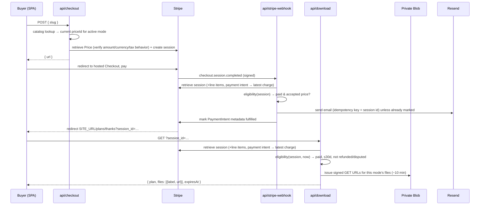

# feat: Plans storefront with Stripe Checkout and secure PDF delivery

## Summary

Add a `/plans` storefront to masonstevens.dev in the Broadside style, with a catalog page, a detail page for each SketchUp build plan, and a post-purchase page. Buyers pay through Stripe's hosted Checkout, US-only at launch. Three Vercel functions, the site's first backend, handle:

- creating the checkout
- receiving the Stripe webhook
- issuing short-lived download links to plan files kept in a private Vercel Blob store

One email, sent through Resend, links the buyer back to the post-purchase page. Stripe is the only record of orders, so there is no database.

---

## Problem Frame

`masonstevens.dev` is meant to sell the SketchUp plans behind the build videos. The channel and the site are one funnel, and Stripe is the chosen processor (`~/AI-OS/context/about-business.md`). Nothing is wired up today. The site is a static Vite + React SPA on Vercel with no server code, no environment variables and no order storage.

The brand sets a constraint of its own: *"Sell the plans in the system... A product page that looks like a generic storefront breaks the one thing this brand is doing well"* (`~/AI-OS/brand-assets/AGENTS.md`). The storefront therefore has to read as part of the same printed publication as the plan sheets: PLATE captions, double rules and a tabular cut list, not off-the-shelf shop UI.

No plan is ready to sell yet. The whole pipeline is still being built now (user decision) and verified end-to-end in test mode, so the storefront also has to launch honestly when some or all of its plans are not for sale.

---

## Requirements

**Storefront pages**
- R1. A `/plans` index lists every *listed* plan in the catalog. A detail page per plan (`/plans/:slug`) shows:
  - its plates
  - its description
  - what's included (format and sheet count)
  - a materials/cut-list preview
  - the price
- R3. A plan with no current price for the active mode shows a "coming soon" state instead of a Buy action. The pages still work when no plan is buyable at all.
- R12. A "Plans" link in the home header reaches the storefront.
- R13. The storefront works at phone widths and is usable by keyboard and screen reader. This covers the cut-list table, plate alt text, announced status and error text, and focus on result changes.

**Checkout and pricing**
- R2. A buyable plan has a Buy action that sends the buyer to Stripe hosted Checkout for a one-time payment.
- R4. Price is never taken from the client. The server maps a plan slug to a Stripe Price through the catalog allowlist and fails closed when they disagree.
- R9. Stripe Tax computes US sales tax on Checkout (tax-exclusive prices), Stripe sends the payment receipt, and sales are limited to US buyers at launch.

**Fulfillment and access**
- R5. After payment the buyer lands on a post-purchase page that gives expiring download links for that plan's files, but only once Stripe confirms the session is paid.
- R6. The buyer receives one email with a durable link back to the post-purchase page, even if they never reach it in the browser. Webhook retries do not send duplicates.
- R7. Plan files are never publicly addressable. Download URLs expire within minutes, and a paid session's access window is limited to 30 days.
- R8. Fully refunded or disputed purchases stop issuing download links. Partial refunds keep access.

**Modes and brand**
- R10. The storefront honours Broadside, and the existing brand guardrail test covers every new UI file.
- R11. Test and live Stripe modes are fully separated: keys, webhook secrets, Price IDs and the files a purchase unlocks. Test-mode purchases can never reach real plan files.

---

## Scope Boundaries

- No customer accounts, order history or re-download portal. The emailed link plus Stripe's receipt is the v1 support model.
- No subscriptions, bundles, cart or multi-quantity purchases. Every checkout is exactly one plan.
- No coupons beyond Stripe Checkout's own promotion-code toggle, which is off by default.
- No international sales at launch, and no merchant-of-record setup. US buyers only, with Stripe Tax for US states where registered.
- No database. Stripe is the system of record, so no Upstash, Neon or similar.
- No admin UI. Products and prices are managed in the Stripe Dashboard, and files are uploaded to the Blob store by hand or by script.
- No authoring of plan content and no SketchUp/LayOut sheet styling.
- No framework migration. The site stays a Vite SPA with Vercel functions, not Next.js.
- No embedded Checkout. It would need Stripe.js, CSP changes and COEP checks, and keeping buyers on-site isn't worth that for v1.

### Deferred to Follow-Up Work

- **International sales:** choose between Stripe Managed Payments (merchant of record) and self-registering for EU and UK VAT once there is US sales data.
- **Plans on the home page:** a featured-plan plate in `FeaturedWorkBlock` or a new ARTICLE section once at least one plan is live.
- **Download analytics and per-buyer download caps:** these need a store. Revisit if link sharing becomes a real problem.
- **De-duplicating the project listings** in `ProjectsIndexPage.tsx` and `FeaturedWorkBlock.tsx` into a shared data module. This plan introduces `src/data/`, which makes it natural, but it's unrelated.
- **Capture learnings with `/ce-compound`** after launch: first serverless functions, the Stripe webhook on Vercel, private Blob, and preview protection bypass.

---

## Context & Research

### Relevant Code and Patterns

- `portfolio-website/src/App.tsx` holds one flat `<Routes>` list inside `AnimatePresence` and `AppErrorBoundary`, with static named-export page imports. New routes are added here.
- `portfolio-website/src/pages/ProjectPageTemplate.tsx` is the shared inner-page frame: sticky back bar, display h1, label subtitle and `DoubleRule`. Its back button is hard-coded to `/`, so plan pages need a back target of `/plans`.
- `portfolio-website/src/pages/ProjectsIndexPage.tsx` is the listing pattern to mirror: a typed entry array rendered as an `ink-frame` list, with thin `Rule`s between rows, `PlateImage` thumbnails and `PlateCaption` numbering.
- `portfolio-website/src/components/broadside/` provides `Rule`, `DoubleRule`, `Label`, `SectionHead` (ARTICLE numbering), `PlateCaption`, `TitleBlock` and `PlateImage`. The convention is that callers position and primitives style. Inline `style={{}}` with CSS tokens (`--stock`, `--ink`, `--spruce`, `--maxw`) is the house style.
- `portfolio-website/src/components/home/Header.tsx` is a `NAV` array of in-page anchors. Plans would be its first route link.
- `portfolio-website/src/brand.guardrail.test.ts` walks `src/` and fails on radius, shadows, gradients, blur, heavy borders and banned fonts or tokens. It does **not** walk `api/` or `server/`. That's fine, since neither holds UI.
- `portfolio-website/vitest.config.ts` is standalone, runs in a node environment and only covers `src/**`. It must widen to `server/**`.
- `portfolio-website/tsconfig.json` references `tsconfig.app.json` (`src`, DOM libs, non-strict, `moduleResolution: bundler`) and `tsconfig.node.json` (`vite.config.ts`). Neither covers server code.
- `portfolio-website/package.json` sets `"type": "module"`, so Vercel runs `api/*.ts` as native ESM. Relative imports need explicit `.js` extensions at runtime.
- `portfolio-website/eslint.config.js` lints `**/*.{ts,tsx}` with browser globals. Server files need a Node-globals override.
- `portfolio-website/vercel.json` has a catch-all rewrite from `/(.*)` to `/index.html`. Vercel resolves functions before rewrites, but excluding `api/` stops a mistyped API path from returning HTML with a 200.
- The Vercel Root Directory is `portfolio-website/`, since `vercel.json` and `package.json` live there. Confirm this in the dashboard before U3.
- The root `Dockerfile` is a Claude Code dev sandbox, not a deploy target, so it doesn't conflict with the functions.

### Institutional Learnings

- There is no `docs/solutions/` directory. The Broadside retheme plan (`docs/plans/2026-09-08-001-refactor-broadside-brand-retheme-plan.md`) establishes three conventions that matter here:
  - Brand rules are enforced by a test, not by memory.
  - Tests stay pure-function in a node environment. jsdom and Testing Library were explicitly declined.
  - That plan excluded build-plan content at the time. This plan is the deliberate decision to add it.
- The dev server sets `COEP: credentialless` and `COOP: same-origin` for the calculators remote (`docs/superpowers/specs/2026-05-03-calculators-microfrontend-design.md`). Hosted Checkout is a top-level navigation, so those headers shouldn't interfere. Check the console once in dev anyway.

### External References

- Stripe's fulfillment pattern uses one idempotent fulfill path called from both the webhook and the landing page: https://docs.stripe.com/checkout/fulfillment?ui=full-page
- API version `2026-03-25.dahlia` renamed Checkout `ui_mode` to `hosted_page` / `embedded_page` / `elements`. Older examples using `embedded` or `hosted` fail: https://docs.stripe.com/changelog/dahlia/2026-03-25/updates-available-checkout-session-ui-modes
- Pin the API version to the installed SDK: https://docs.stripe.com/sdks/set-version
- Stripe Tax for digital products: pick a digital tax code on the Product, not `txcd_10000000` for US. https://docs.stripe.com/tax/digital-products and https://docs.stripe.com/tax/tax-codes?type=digital
- Tax behavior on Prices: https://docs.stripe.com/tax/products-prices-tax-categories-tax-behavior
- Receipts: https://docs.stripe.com/receipts
- Vercel Node functions with Web `fetch` handlers, which give a raw body via `req.text()`: https://vercel.com/docs/functions/runtimes/node-js
- Vercel private Blob (GA 2026-06-30) and signed URLs: https://vercel.com/docs/vercel-blob/vercel-signed-urls
- Vercel Deployment Protection and Protection Bypass for Automation: https://vercel.com/docs/deployment-protection
- Resend idempotency keys (24h dedupe): https://resend.com/docs/dashboard/emails/idempotency-keys

---

## Key Technical Decisions

- **Hosted Checkout (`hosted_page`), not embedded.**
  - No Stripe.js in the SPA, no CSP or COEP changes, and the smallest PCI surface.
  - The buyer briefly leaves the site, which is acceptable for a one-plan purchase.
- **US-only at launch, with tax-exclusive pricing (user decision).**
  - Stripe Tax collects US sales tax where you're registered.
  - Every Price is created with tax behavior *exclusive*, so the catalog's display price is the pre-tax amount and the detail page labels it "plus tax".
  - Non-US purchases are blocked. The exact enforcement point, a Stripe Radar rule on card country or a Checkout-level restriction, is confirmed at implementation (see Open Questions).
  - International sales, and the merchant-of-record question, are deferred.
- **Catalog is a typed, framework-free module (`src/data/plans.ts`) shared by the SPA and the functions.**
  - It is the single source of truth for slug, copy, plates, included files, display price, Stripe Prices and Blob files.
  - It imports nothing from React or the DOM, so `api/` can import it.
- **Each plan carries, per mode (`test` / `live`):**
  - one *current* Price ID, used by checkout
  - a list of *accepted* Price IDs, current plus historical, used by eligibility
  - its own file list

  This is needed because Stripe Prices are immutable: any repricing creates a new Price ID, and past buyers inside their 30-day window must keep resolving. Per-mode file lists mean test-mode purchases unlock only placeholder files, never the real plan.
- **Mode is derived from the Stripe key on the server. The SPA's build-time mode must match it or the build fails.**
  - The SPA needs to know the mode at build time to decide whether to show Buy (`VITE_STRIPE_MODE`).
  - A build-time check compares it with the key's mode (`sk_`/`rk_` + `_test_`/`_live_`) whenever both are present, as they are on Vercel builds.
  - A mismatch fails the deploy instead of silently hiding sales or showing Buy buttons that always fail.
- **Display price lives in the catalog, and checkout verifies it against Stripe.**
  - Before creating a session, the checkout function retrieves the current Price.
  - It refuses (fails closed and logs) unless amount, currency and tax behavior (exclusive) all match.
  - Drift becomes a visible failed checkout, not a silent wrong charge.
- **No database. One eligibility function decides everything from the Stripe session.**
  - The webhook and the download endpoint both run the same pure decision: paid, within the access window, not fully refunded, not disputed, and the line item maps to an accepted Price ID.
  - Stripe is the record. No download counts and no revocation beyond refunds and disputes is accepted for v1.
- **The session ID is a bearer token, with limits.**
  - A paid session grants access for 30 days from creation.
  - Signed file URLs live about 10 minutes.
  - The email links to the post-purchase page, never to raw signed URLs.
  - The post-purchase page is served with `Referrer-Policy: no-referrer` and loads no third-party resources.
- **Files live in a private Vercel Blob store.**
  - It stays on the existing vendor, uses OIDC auth on Vercel (no static token) and supports signed GET URLs.
  - Pathnames aren't secret; access needs a signed token.
- **Email dedupe uses a Resend idempotency key derived from the session ID, plus a PaymentIntent metadata marker.**
  - The key covers concurrent and short-window retries. The marker covers Stripe's retries for up to 3 days.
  - Residual risk, accepted: if the marker write keeps failing for more than 24h, a late Stripe retry can send a second email.
- **The webhook uses the Web `fetch` handler signature.**
  - It reads the raw body with `req.text()` for signature verification.
  - It handles `checkout.session.completed` and `checkout.session.async_payment_succeeded`, and fulfills only when `payment_status` is `paid`.
  - It responds quickly, because Checkout waits up to 10s before redirecting.
- **Server code lives in `portfolio-website/api/` (thin handlers) and `portfolio-website/server/` (logic), compiled as Node ESM.**
  - A third TypeScript project (`tsconfig.server.json`) uses `NodeNext` module resolution, Node types and strict mode, and is added to the `tsc -b` references.
  - Relative imports (including into `src/data/`) carry explicit `.js` extensions, because Vercel transpiles rather than bundles and `"type": "module"` makes extensionless imports fail at runtime.
  - Decision logic is pure and takes already-fetched Stripe objects, so it's testable in the existing node vitest setup.
- **`SITE_URL` is per environment and never read from request headers.**
  - Production uses an explicit `https://masonstevens.dev`.
  - Preview and Development fall back to `https://` plus Vercel's `VERCEL_BRANCH_URL` (or localhost), so success redirects and email links land on the same deployment that created the session.
- **Previews are protected, and Stripe reaches them through a bypass.**
  - Vercel Deployment Protection stays on for previews, since they carry test-mode checkout.
  - The test-mode webhook endpoint targets a stable branch alias with Vercel's Protection Bypass for Automation secret.
- **Post-purchase route is `/plans/thanks`, and `thanks` is a reserved slug.**
  - React Router ranks the static segment above `:slug`.
  - A catalog test forbids the collision.

---

## Open Questions

### Resolved During Planning

- **Delivery model:** secure auto-delivery through a Stripe webhook, a Vercel function and expiring links (user choice).
- **Tax and geography:** US-only at launch with Stripe Tax and tax-exclusive prices. International sales are deferred (user choice).
- **Sequencing:** build all units now and verify in test mode. U1–U2 still ship correctly on their own as a coming-soon storefront (user choice).
- **Detail page order:** title, then buy block beside the lead plate, then plates, What's included and cut list (user choice; see U2).
- **Where do functions live, given the Vercel root?** In `portfolio-website/api/`. Confirm the Root Directory in the dashboard.
- **Does the catch-all rewrite swallow `/api`?** No. Still exclude `api/` so unknown API paths return a 404.
- **Hosted vs embedded:** hosted.
- **Storage vendor:** Vercel private Blob, over R2 or S3.

### Deferred to Implementation

- **Stripe-node version:** pin `apiVersion` to whatever the installed SDK ships with.
- **US-only enforcement mechanism:** a Radar rule blocking non-US card country, or a Checkout-level billing restriction. Pick whichever Stripe supports for hosted Checkout at implementation time, and verify it with a non-US test card.
- **Delayed-settlement payment methods:** if Checkout is limited to cards and wallets, the "processing" branch is rarely hit but stays handled. If delayed methods are enabled, measure the 30-day window from payment rather than from session creation.
- **Stripe tax code for "PDF plan set":** choose from the digital-goods list when creating the first Product. This is a Dashboard setting, not code.
- **Caching the Blob signed token across warm invocations:** measure once deployed. Correctness doesn't depend on it.
- **Email copy and sender domain:** needs a verified sending domain in Resend before live mode.
- **Exact cut-list columns:** settle in U2 against the first real plan, modelled on the comp's bill-of-materials table.

---

## Output Structure

    portfolio-website/
    ├── api/
    │   ├── checkout.ts            # POST slug → Stripe hosted Checkout URL
    │   ├── stripe-webhook.ts      # verify signature → fulfill (email)
    │   └── download.ts            # GET session_id → signed file URLs
    ├── server/
    │   ├── config.ts              # env loading, Stripe mode, SITE_URL per environment
    │   ├── stripe.ts              # Stripe client (pinned apiVersion)
    │   ├── checkout.ts            # pure slug→price resolution, price verification, session params
    │   ├── checkout.test.ts
    │   ├── fulfillment.ts         # pure eligibility decision + fulfill orchestration
    │   ├── fulfillment.test.ts
    │   ├── blob.ts                # signed GET URL issuance
    │   └── email.ts               # Resend send with idempotency
    ├── src/
    │   ├── data/
    │   │   ├── plans.ts           # typed catalog (shared with server)
    │   │   ├── plans.test.ts
    │   │   ├── checkoutClient.ts  # Buy response interpretation
    │   │   └── checkoutClient.test.ts
    │   └── pages/plans/
    │       ├── PlansIndexPage.tsx
    │       ├── PlanDetailPage.tsx
    │       └── PlanThanksPage.tsx
    └── tsconfig.server.json
    docs/
    └── plans-storefront-runbook.md

---

## High-Level Technical Design

> *This illustrates the intended approach and is directional guidance for review, not implementation specification. The implementing agent should treat it as context, not code to reproduce.*

The eligibility decision is one pure function used by both the webhook and the download endpoint:

| Session state | Webhook outcome | Download outcome |
|---|---|---|
| paid, accepted Price ID, ≤30 days, not refunded or disputed | send email (once) | signed URLs |
| `unpaid` (delayed method pending) | ack, no-op; wait for `async_payment_succeeded` | processing |
| paid but older than 30 days | n/a | expired |
| charge fully refunded | no email | refunded |
| charge disputed (open or lost) | no email | disputed (same copy as refunded) |
| line item Price ID not accepted by any plan | ack, log loudly | unknown purchase |
| malformed or wrong-mode session ID | n/a | not found |

---

## Implementation Units

- U1. **Plans catalog module**

**Goal:** A typed, framework-free catalog that both the SPA and the server import.

**Requirements:** R1, R3, R4, R11

**Dependencies:** None

**Files:**
- Create: `portfolio-website/src/data/plans.ts`
- Test: `portfolio-website/src/data/plans.test.ts`

**Approach:**
- Each entry carries:
  - slug and title
  - `listed` flag
  - short and long description
  - format line (e.g. "PDF, 6 sheets + SketchUp file")
  - plate images with alt text (paths under `public/assets/plans/`)
  - included-items list
  - materials/cut-list preview rows (qty, part, dimension)
  - display price in minor units, plus currency (pre-tax)
  - per mode (`test` / `live`): current Price ID, accepted Price IDs (always including current), and file entries (label + Blob pathname)
- Test-mode file entries point at placeholder files, never at the real plan.
- Export small pure helpers:
  - listed entries
  - lookup by slug
  - lookup by accepted Price ID for a given mode
  - "is buyable in mode X" (has a current Price ID for that mode)
- No React, DOM or `import.meta.env` imports. The module must load cleanly under Node.
- Seed it with the first real plan (e.g. the Tool Rack), listed, with no live Price ID. Test-mode IDs get added once the test Product exists.
- Retiring a plan means setting `listed: false`, never deleting the entry.
- Repricing means appending the old Price ID to the accepted list and replacing the current one.

**Patterns to follow:**
- The `ProjectEntry` typed array in `portfolio-website/src/pages/ProjectsIndexPage.tsx`.

**Test scenarios:**
- Happy path: lookup by an existing slug returns its entry. Lookup by its test current Price ID in test mode returns the same entry.
- Happy path: a historical Price ID present only in a plan's accepted list still resolves to that plan.
- Edge case: lookup by an unknown slug or Price ID returns nothing and does not throw.
- Edge case: a test Price ID looked up in live mode returns nothing.
- Edge case: an entry with a live current Price ID only is buyable in live mode and not in test mode, and vice versa.
- Edge case: an unlisted entry is excluded from listed entries, but its Price IDs still resolve.
- Invariant: slugs are unique, URL-safe and never the reserved `thanks`.
- Invariant: no Price ID appears in more than one plan's accepted lists, across both modes.
- Invariant: each mode's current Price ID is contained in that mode's accepted list.
- Invariant: every mode with a current Price ID has at least one file, and the plan has a positive display price.
- Invariant: test-mode and live-mode file pathnames never overlap.

**Verification:**
- Catalog tests pass. Importing the module from a plain Node context has no DOM dependency.

---

- U2. **Storefront pages, routing and build-time mode check**

**Goal:** The `/plans` index and `/plans/:slug` detail pages in Broadside, with coming-soon handling, a Plans link in the home header, and a build check that keeps the SPA's mode honest.

**Requirements:** R1, R3, R10, R12, R13

**Dependencies:** U1

**Files:**
- Create: `portfolio-website/src/pages/plans/PlansIndexPage.tsx`
- Create: `portfolio-website/src/pages/plans/PlanDetailPage.tsx`
- Modify: `portfolio-website/src/App.tsx`
- Modify: `portfolio-website/src/pages/ProjectPageTemplate.tsx` (optional back target and label)
- Modify: `portfolio-website/src/components/home/Header.tsx`
- Modify: `portfolio-website/vite.config.ts` (build-time mode agreement check)
- Test: `portfolio-website/src/brand.guardrail.test.ts` (existing; must keep passing over the new files)

**Approach:**
- **Index**
  - Mirrors the projects index list: plate thumbnail, `PlateCaption` "PLATE N", display title, then either the price ("plus tax") or a "Coming soon" label, linking to the detail page.
  - When nothing is buyable, a short line under the title says plans are on the way and points to where launches are announced (the YouTube channel).
- **Detail page order** (user decision):
  1. Display title and short description.
  2. Buy block, a `TitleBlock`-style unit containing the price ("plus tax"), the format line and the Buy action. It sits beside the lead plate on desktop and directly under the title on mobile.
  3. Remaining plates with `PlateCaption`s.
  4. `SectionHead` ARTICLE sections for "What's included" (long description and included items) and "Materials".
  5. The cut-list table: tabular figures and hairline rules at screen weights, modelled on the bill-of-materials table in `~/AI-OS/brand-assets/comp-broadside-locked.html`.
- **Coming-soon plans** show the same page with the Buy block's action replaced by a coming-soon label and the announcement pointer. Never a disabled button that looks clickable.
- **Unknown or unlisted-but-unknown slug:** a short "No such plan" state with a link back to `/plans`. Unlisted plans with a valid slug still render, so past buyers' links work.
- **Responsive and accessibility:**
  - The cut-list table scrolls horizontally inside a labelled region on narrow screens.
  - Plates use the catalog's alt text.
  - The Plans link and Buy action meet touch-target size.
  - Visible focus styles use ink, not a shadow.
- **`ProjectPageTemplate`** gains an optional back target and label, defaulting to the current `/` and "Back to Home". Plan pages use `/plans` / "All Plans".
- **Header** gets a "Plans" entry as a router `Link`, not an anchor. `NAV` needs a small discriminator for route vs in-page items, and it must still wrap cleanly at phone widths.
- **Buyability** comes from `VITE_STRIPE_MODE` plus the catalog's current Price ID for that mode.
  - The vite config fails the build when `VITE_STRIPE_MODE` and the Stripe key's mode disagree. It skips the check when the key isn't present, as in local SPA-only dev.
  - The server stays authoritative: U3 refuses anyway.
- The Buy action's behaviour lands in U4. Here it can be a stub.

**Patterns to follow:**
- `portfolio-website/src/pages/ProjectsIndexPage.tsx` list structure.
- `portfolio-website/src/components/broadside/` primitives.

**Test scenarios:**
- Integration: the brand guardrail passes with the new page files present (no radius, shadow, gradient, blur or heavy border).
- Test expectation for rendering: none beyond the guardrail, since the repo deliberately has no DOM test setup. Rendering, responsive and keyboard behaviour are verified manually (see Verification).

**Verification:**
- `/plans` lists the seeded plan as coming soon. `/plans/<slug>` renders in the agreed order. `/plans/nope` shows the not-found state.
- The home header links to `/plans`. Existing project pages still show "Back to Home".
- At 375px width the cut-list table scrolls inside its region with no page-level horizontal scroll.
- Tabbing reaches the Plans link, Buy and back links with visible focus.
- A Vercel build with `VITE_STRIPE_MODE=live` and a test key fails.

---

- U3. **Server foundation and checkout endpoint**

**Goal:** The site's first Vercel functions, covering config, Stripe client and tooling, plus the endpoint that turns a slug into a hosted Checkout URL.

**Requirements:** R2, R4, R9, R11

**Dependencies:** U1

**Files:**
- Create: `portfolio-website/api/checkout.ts`
- Create: `portfolio-website/server/config.ts`
- Create: `portfolio-website/server/stripe.ts`
- Create: `portfolio-website/server/checkout.ts`
- Create: `portfolio-website/tsconfig.server.json`
- Modify: `portfolio-website/tsconfig.json` (add reference)
- Modify: `portfolio-website/vitest.config.ts` (include `server/**/*.test.ts`)
- Modify: `portfolio-website/eslint.config.js` (Node globals for `api/` and `server/`)
- Modify: `portfolio-website/vercel.json` (exclude `api/` from the SPA rewrite)
- Modify: `portfolio-website/package.json` (add `stripe`, `@types/node`)
- Test: `portfolio-website/server/checkout.test.ts`

**Approach:**
- **Config**
  - Reads and validates the Stripe and site variables at first use, failing loudly when they're missing: `STRIPE_SECRET_KEY`, `STRIPE_WEBHOOK_SECRET`, and `SITE_URL` in Production.
  - Email variables are validated separately in U6.
  - Mode comes from the key prefix, accepting `sk_` or `rk_` with `_test_` / `_live_`.
  - `SITE_URL` resolves as explicit in Production and from `VERCEL_BRANCH_URL` (or localhost) elsewhere, never from request headers.
- **Stripe client:** pins `apiVersion` to the installed SDK's version.
- **Pure checkout logic**
  - Resolution takes (slug, mode, catalog) and returns either the current Price ID or a refusal reason.
  - Verification compares a retrieved Price against the catalog (amount, currency, tax behavior exclusive).
  - A param builder produces:
    - `hosted_page` UI mode, `mode: payment`, quantity 1
    - `success_url` = `SITE_URL/plans/thanks?session_id={CHECKOUT_SESSION_ID}`
    - `cancel_url` = the plan detail page
    - automatic tax on and billing address required
    - slug metadata
- **Handler**
  - POST only. Parses a JSON slug, resolves, retrieves the Price, verifies, creates the session and returns its URL.
  - All refusals return a generic client error. Details, including a distinct "buyable only in other mode" reason, go to server logs.
- **Imports:** all relative imports in `api/` and `server/` use explicit `.js` extensions under `NodeNext` resolution, including the import of the catalog in `src/data/`.
- **Rewrite:** change it so only non-`api/` paths go to `index.html`.

**Execution note:** Write the pure resolution, verification and param-builder tests first. They form the price-integrity boundary.

**Patterns to follow:**
- The standalone-vitest-config rationale in `portfolio-website/vitest.config.ts`.

**Test scenarios:**
- Happy path: a buyable slug in test mode resolves to its test current Price ID.
- Happy path: the session params contain exactly one line item with quantity 1, success and cancel URLs built from the resolved `SITE_URL`, automatic tax and slug metadata.
- Error path: an unknown slug is refused with "unknown plan".
- Error path: a known slug with no current Price ID in the active mode is refused with "not for sale". When it is buyable in the other mode, the reason is logged as a mode mismatch.
- Error path: catalog 2900 USD vs Stripe 3900 USD is refused with "price mismatch". A currency mismatch and tax behavior `unspecified` or `inclusive` are refused the same way.
- Edge case: a slug with whitespace or the wrong case doesn't match. Matching is exact.
- Edge case: the success URL contains the literal `{CHECKOUT_SESSION_ID}` placeholder, not an encoded form.
- Error path: config with a missing Stripe variable throws a named error listing it. A key prefix that matches no known mode is rejected.
- Edge case: `SITE_URL` resolution returns the explicit value in Production, `https://<branch url>` in Preview, and ignores any request-derived host.

**Verification:**
- `tsc -b` typechecks server code, and vitest runs the server tests.
- On a preview deploy, the function actually responds; typechecking alone isn't enough. This guards against runtime ESM resolution errors.
- On a preview deploy with test keys, posting a buyable slug returns a `checkout.stripe.com` URL showing the right product, pre-tax price and a tax line. A coming-soon slug is refused.

---

- U4. **Buy action wiring**

**Goal:** The detail page's Buy action calls the checkout endpoint and redirects, with honest pending and error states.

**Requirements:** R2, R13

**Dependencies:** U2, U3

**Files:**
- Modify: `portfolio-website/src/pages/plans/PlanDetailPage.tsx`
- Create: `portfolio-website/src/data/checkoutClient.ts` (small fetch wrapper with pure response handling)
- Test: `portfolio-website/src/data/checkoutClient.test.ts`

**Approach:**
- Clicking Buy disables the action and changes its label to a pending wording while pending. This prevents double sessions from double clicks.
- It POSTs the slug, then does a top-level navigation to the returned URL.
- On failure, a plain inline message in brand voice appears directly under the Buy action, in an `aria-live` region, and the action re-enables. Never show raw server errors.
- The action also re-enables on `pageshow`, so returning with the browser back button from Stripe doesn't leave it stuck.
- Cancel returns to the detail page with no extra banner.
- Response interpretation (success URL vs error) is a pure function, testable without a DOM.

**Test scenarios:**
- Happy path: a response with a `checkout.stripe.com` URL is accepted as the redirect target.
- Error path: a non-2xx response or malformed body becomes the generic failure state.
- Error path: a returned URL not on Stripe's checkout origin is rejected. This defends against a misconfigured server.

**Verification:**
- Clicking Buy on preview reaches Stripe Checkout, and cancelling returns to the detail page.
- A double click creates one session.
- Using the browser back button from Checkout leaves Buy enabled.

---

- U5. **Fulfillment: eligibility, signed downloads, thanks page**

**Goal:** One pure eligibility decision, a download endpoint that issues short-lived signed URLs, and the `/plans/thanks` page.

**Requirements:** R5, R7, R8, R11, R13

**Dependencies:** U1, U3

**Files:**
- Create: `portfolio-website/server/fulfillment.ts`
- Create: `portfolio-website/server/blob.ts`
- Create: `portfolio-website/api/download.ts`
- Create: `portfolio-website/src/pages/plans/PlanThanksPage.tsx`
- Modify: `portfolio-website/src/App.tsx` (add `/plans/thanks` above `/plans/:slug`)
- Modify: `portfolio-website/vercel.json` (`Referrer-Policy: no-referrer` header on `/plans/thanks`)
- Modify: `portfolio-website/package.json` (add `@vercel/blob`)
- Test: `portfolio-website/server/fulfillment.test.ts`

**Approach:**
- **Eligibility function**
  - Takes an already-retrieved session (line items, plus the PaymentIntent's latest charge with refund and dispute state), the current time, the active mode and the catalog.
  - Returns either "eligible + plan + this mode's files" or one specific reason from the table in High-Level Technical Design. It does no I/O.
- **Download handler**
  1. Validates the session ID: the active mode's prefix (`cs_test_` / `cs_live_`), an alphanumeric/underscore charset and a generous maximum length. No exact-length check, since Stripe ID lengths can change.
  2. Retrieves the session with line items and `payment_intent.latest_charge` expanded.
  3. Runs eligibility.
  4. On success, issues one signed GET URL per file (~10 minutes validity).
  5. Returns the plan title, labelled URLs and their expiry, with `Cache-Control: no-store`.
- **Thanks page**
  - Reads `session_id` and then strips it from the address bar.
  - Loads no third-party resources.
  - Uses `ProjectPageTemplate` with back target `/plans`.
  - Every state ends with exits to All Plans and Home. On a result change, focus moves to the status heading, and status text sits in an `aria-live` region.

  | State | Message intent | Primary action | "Check your email" line |
  |---|---|---|---|
  | Loading | Retrieving your plan | — | no |
  | Eligible | Plan title, receipt-style block, file list, "links expire in 10 minutes" | Download each file; **Refresh links** re-calls the endpoint without a reload | yes ("a copy of this page's link is on its way") |
  | Processing | Payment still settling | Refresh | no |
  | Expired | 30-day window passed | Contact (reply-to email) | no |
  | Refunded / disputed | Purchase was refunded or disputed | Contact | no |
  | Unknown purchase | Paid, but we can't match it to a plan | Contact | no |
  | Not found / malformed | We couldn't find that purchase | Back to All Plans | no |
  | Network or server error | Something went wrong on our side | Retry | no |

  Stale links are handled by the Refresh action. Once the expiry passes, the file list is visibly marked expired and prompts a refresh, so the buyer never lands on a raw Blob error from the page.
- **Private Blob store:** a dedicated private store. Live files and test placeholder files are uploaded out of band, and their pathnames are recorded in the catalog per mode.

**Execution note:** Implement the eligibility function test-first. It is the access-control boundary for paid files.

**Patterns to follow:**
- Stripe's "one fulfill function, two callers" pattern (External References).

**Test scenarios:**
- Happy path: a paid session created 1 day ago, with an accepted line-item Price ID and an undisputed, unrefunded charge, is eligible and returns that plan's files for the active mode.
- Happy path: a session paid with a now-historical Price ID (moved to the accepted list after repricing) is still eligible.
- Edge case: a session created exactly 30 days ago is eligible. At 30 days plus 1 second it gives "expired".
- Error path: `payment_status` `unpaid` gives "processing". `no_payment_required` is not treated as paid.
- Error path: a fully refunded charge gives "refunded". A partially refunded charge stays eligible.
- Error path: a disputed charge gives "disputed", whether the dispute is open or lost.
- Error path: a line-item Price ID not accepted by any plan gives "unknown purchase".
- Error path: a session with zero or multiple line items gives "unknown purchase". v1 sells exactly one plan per session.
- Error path: a test-mode session ID presented to a live-mode server is rejected before any Stripe call. Wrong prefix and bad charset are rejected the same way. A longer-than-usual but valid-charset ID is accepted.
- Integration: eligibility selects files from the entry matched by accepted Price ID, not by the slug in session metadata. Tampered metadata cannot redirect to another plan's files.
- Integration: in test mode, eligible results return only the test-mode (placeholder) file pathnames, never live ones.

**Verification:**
- After a test-mode purchase on preview, `/plans/thanks` lists working links to the *placeholder* files.
- The links stop working after their validity window, and Refresh issues new ones.
- A direct Blob URL without a signature is refused.
- Refunding the test payment turns the page into the refunded state.
- The `session_id` disappears from the address bar after load.

---

- U6. **Webhook and download email**

**Goal:** A Stripe webhook that verifies signatures and sends exactly one email per paid session, linking back to the post-purchase page.

**Requirements:** R6, R8, R9

**Dependencies:** U5

**Files:**
- Create: `portfolio-website/api/stripe-webhook.ts`
- Create: `portfolio-website/server/email.ts`
- Modify: `portfolio-website/server/config.ts` (email variables: `RESEND_API_KEY`, `EMAIL_FROM`, validated only when email is used)
- Modify: `portfolio-website/server/fulfillment.ts` (fulfill orchestration: eligibility → already-marked check → send → mark)
- Modify: `portfolio-website/package.json` (add `resend`)
- Test: `portfolio-website/server/fulfillment.test.ts`

**Approach:**
- **Handler**
  - A Web `fetch`-style handler reads the raw text body and verifies it with the async signature constructor against the mode's webhook secret.
  - A bad signature returns a 400 with no detail.
  - Routes only `checkout.session.completed` and `checkout.session.async_payment_succeeded`. Other events are acknowledged and ignored.
- **Orchestration**
  1. Retrieve the session with expansions.
  2. Run eligibility.
  3. Skip if the PaymentIntent is already marked fulfilled.
  4. Send the email with idempotency key `plan-download/<session id>`.
  5. Mark the PaymentIntent metadata.

  Resend's "concurrent idempotent request" response counts as success.
- **Email content:** the plan title, a link to `SITE_URL/plans/thanks?session_id=…`, the 30-day window and a reply-to for support. It never contains a raw signed URL.
- **Responses**
  - Acknowledge promptly.
  - Failures after verification return 5xx so Stripe retries.
  - Expected ineligibility (unpaid, unknown, refunded or disputed) returns 2xx with a log entry so Stripe doesn't retry forever.
  - Don't log raw payloads, which contain buyer PII. Log session IDs and outcomes.
- **Receipts:** Stripe's own "successful payment" receipt emails are turned on in the Dashboard (R9). Nothing is built for receipts.

**Test scenarios** (orchestration takes injected send, mark and retrieve functions, so it's testable in node):
- Happy path: an eligible, unmarked session sends one email with the expected idempotency key and thanks-page link, then marks it.
- Edge case: an already-marked session sends nothing and returns success.
- Edge case: a `completed` event with `unpaid` status sends nothing and returns success with no retry. A later `async_payment_succeeded` for the same session sends.
- Error path: if the email send fails, the session isn't marked and the result is retryable. The retry sends with the same idempotency key.
- Error path: if the mark fails after a successful send, the result is retryable. The retried send hits the idempotency key within 24h, so there's no duplicate.
- Error path: a refunded, disputed or unknown session sends nothing and returns non-retryable, logged.
- Error path: a missing email variable fails only the email path with a named config error. Checkout and download are unaffected.
- Integration (manual, Stripe CLI): `stripe listen` forwarding to the preview branch alias, with the protection-bypass parameter, delivers a signed `checkout.session.completed`, and exactly one email arrives. `stripe events resend` doesn't produce a second email.

**Verification:**
- A test purchase yields one email whose link opens a working thanks page. Re-sending the event from the Stripe Dashboard produces no duplicate.

---

- U7. **Go-live configuration and runbook**

**Goal:** Everything outside the code that has to exist for test mode and then live mode, written down so it's repeatable.

**Requirements:** R9, R11

**Dependencies:** U3–U6

**Files:**
- Create: `docs/plans-storefront-runbook.md`
- Modify: `portfolio-website/README.md` (env vars, local dev with `vercel dev`, `vercel env pull` for Blob OIDC, and `stripe listen`)

**Approach:** the runbook covers the following.
- **Vercel prerequisites**
  - Confirm the plan tier permits commercial use (Pro) and supports WAF rate-limit rules.
  - Confirm the Root Directory is `portfolio-website/`.
- **Stripe, per mode:**
  - Products with a digital tax code.
  - Prices with tax behavior *exclusive*.
  - Stripe Tax US registrations.
  - The US-only enforcement (see Open Questions).
  - Receipt emails on and Radar on.
  - A restricted API key (`rk_`) scoped to: create Checkout Sessions; read Prices, Sessions and Charges; update PaymentIntent metadata.
  - Webhook endpoints subscribed to both event types.
- **Test-mode webhook target:** a stable preview branch alias with Vercel Protection Bypass for Automation appended. Deployment Protection stays on for previews.
- **Vercel env vars per environment, kept as a pair:**
  - Preview and Development: test key with `VITE_STRIPE_MODE=test`.
  - Production: live key with `VITE_STRIPE_MODE=live`.
  - Plus webhook secrets, `SITE_URL` (Production only), Resend key and `EMAIL_FROM`.
- **Private Blob store:** connect it, then upload live files and test placeholders.
- **Resend:** verify the sending domain on masonstevens.dev.
- **WAF rate-limit rules** on `/api/checkout` and `/api/download`.
- **Rotation:** steps for API keys and webhook secrets.
- **Repricing:** create a new Price, move the old ID to the plan's accepted list, then set the new current ID.
- **Retiring a plan:** set `listed: false` and never delete the entry.
- **Pre-launch checklist.** This is a gate before adding any live Price ID:
  - full test-mode purchase → email → download (placeholders) → Refresh → refund → refunded state, all on the preview alias
  - a non-US test card is blocked
  - a test email from the production sender is delivered
  - WAF rules are active

**Test expectation:** none. This unit is documentation and configuration.

**Verification:**
- Someone following only the runbook can take a new plan from SketchUp export to buyable in live mode.

---

## System-Wide Impact

- **Interaction graph**
  - New flows:
    - SPA → `api/checkout` → Stripe
    - Stripe → `api/stripe-webhook` → Resend
    - SPA → `api/download` → Stripe + Blob
  - Existing SPA routes, Module Federation remotes and error boundaries are untouched apart from the new routes in the same `Routes` list and the Plans header link.
- **Error propagation**
  - Server refusals reach the browser as generic messages, with details only in Vercel logs.
  - Webhook failures surface as Stripe retries and in the Dashboard's failed-delivery view, which serves as the operational alarm.
  - A mode mismatch fails the build rather than reaching visitors.
- **State lifecycle risks**
  - Duplicate emails from retries or concurrency are covered by the idempotency key plus the metadata marker. There is a small accepted residual beyond 24h.
  - Price drift between the catalog and Stripe fails closed at checkout.
  - Repricing and retirement keep past buyers resolvable through the accepted Price IDs and the `listed` flag.
- **API surface parity:** the catalog is the single shared contract between the SPA and the server. Both compile against the same types.
- **Unchanged invariants**
  - Existing pages keep their "Back to Home" default.
  - The brand guardrail rules are unchanged and still scan all of `src/`.
  - The calculators remote and the COEP/COOP dev headers are unchanged.

---

## Risks & Dependencies

| Risk | Mitigation |
|------|------------|
| Leaked or forwarded session ID grants downloads | 30-day window, ~10-min signed URLs, refunds and disputes revoke, no-referrer header, session ID stripped from the URL, WAF rate limit. Accepted residual for a low-price digital good |
| Test-mode purchase unlocks real files | Per-mode file lists with test placeholders, catalog invariant against overlap, Deployment Protection on previews |
| Test/live mix-up | Mode from key, build-time agreement check with `VITE_STRIPE_MODE`, Price IDs and files keyed by mode, session ID prefix checked against mode |
| Catalog price drifts from Stripe, or tax behavior unset | Checkout verifies amount, currency and exclusive tax behavior, and fails closed |
| Repricing orphans past buyers | Accepted Price ID list per mode; the runbook's repricing procedure |
| ESM import resolution fails only at runtime | `NodeNext` with explicit `.js` imports; U3 verification requires a deployed function response |
| Webhooks blocked by preview protection | Stable branch alias with Protection Bypass for Automation (runbook) |
| Old examples use pre-dahlia `ui_mode` values | Pin `apiVersion` to the installed SDK; use `hosted_page` |
| Slow webhook delays the Checkout redirect | Handler does only verify → retrieve → send → mark |
| Non-US buyers create tax obligations | US-only enforcement verified with a non-US test card before launch; international sales deferred |
| Vercel Hobby tier disallows commercial use | Runbook prerequisite: confirm Pro before any live Price ID |
| Resend domain not verified at launch | Runbook gate: a test email from the production sender must arrive before live |
| Full-privilege key leak | Restricted `rk_` key scoped to the needed operations, plus rotation steps |

---

## Documentation / Operational Notes

- `docs/plans-storefront-runbook.md` (U7) is the operational source of truth. The README points to it.
- Monitoring for v1:
  - Stripe Dashboard webhook delivery failures.
  - Vercel function logs filtered on refusal reasons ("price mismatch", "mode mismatch", "unknown purchase").
  - Resend delivery logs.
- Support path: a buyer who lost their email replies to it. You find the session by email in the Stripe Dashboard and resend the thanks link.

---

## Sources & References

- Brand constraints: `~/AI-OS/brand-assets/AGENTS.md` ("Sell the plans in the system"), `~/AI-OS/brand-assets/brand-kit.md`, `~/AI-OS/brand-assets/comp-broadside-locked.html`
- Business context: `~/AI-OS/context/about-business.md`
- Prior plan and conventions: `docs/plans/2026-09-08-001-refactor-broadside-brand-retheme-plan.md`
- Related code: `portfolio-website/src/App.tsx`, `portfolio-website/src/pages/ProjectPageTemplate.tsx`, `portfolio-website/src/pages/ProjectsIndexPage.tsx`, `portfolio-website/src/brand.guardrail.test.ts`, `portfolio-website/vercel.json`, `portfolio-website/package.json`
- External: see Context & Research, External References
